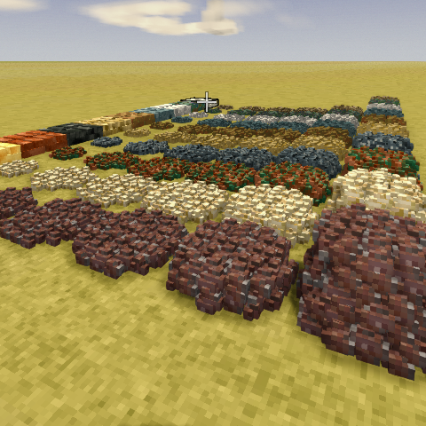

# Vintage Story mod Ore Piles (512-Capacity Nugget & Metal Bit Ground Storage)

{width=500}

## Features

- **512-Item Ground Storage:** Store up to 512 raw ore nuggets (`nugget-*`) or metal bits/alloys (`metalbit-*`, including Tin Bronze, Bismuth Bronze, Black Bronze, Brass, Iron, and Steel) in a single block.
- **Exact 1:1 Visual Representation:** Every item placed into the pile renders one full-scale (`1.0`) 5-cube vanilla nugget (`2,560` elements total at full capacity).
- **Non-Overlapping Dome Geometry:** Collision-checked placement ensures individual nuggets touch without clipping, with inward-stepped rows so edge pieces never float.
- **1x1x1 Block Bounds & Vanilla Audio:** Fits cleanly inside a single block's selection/collision hitbox (`cbScaleYByLayer: 0.021`) while preserving vanilla placement sounds and `ArtPigment` cave-painting behaviors on hematite and limonite.

## Controls

- **Place 1 item:** `Ctrl + Right-Click` on a solid surface
- **Place 16 items (bulk):** `Ctrl + Shift + Right-Click`
- **Pick up 1 item:** `Right-Click` on the pile
- **Pick up 16 items (bulk):** `Shift + Right-Click` on the pile

## Regenerating the 3D Pile Model

The pile shape (`assets/orepiles/shapes/item/nugget-pile.json`) is procedurally generated by `make-pile.py`.

- **Seed used in this build:** `829845863`

To reproduce this exact layout, run:

```bash
py make-pile.py 829845863
```

## Installation

1. Place `OrePiles-1.0.1.zip` into your Vintage Story `Mods` folder (`%AppData%\VintagestoryData\Mods` on Windows or `~/.config/VintagestoryData/Mods` on Linux).
2. Enable **Ore Piles** in the Mod Manager and load your world.
